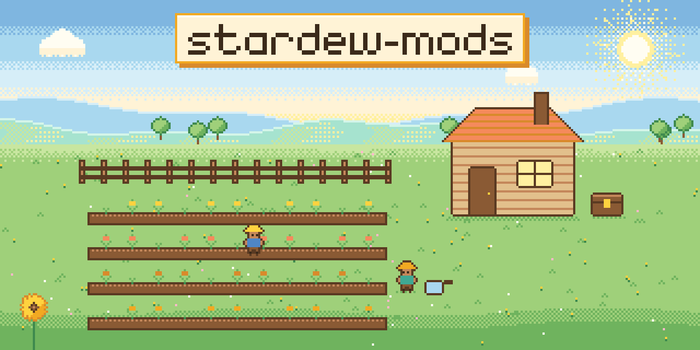

# stardew-mods

Two SMAPI mods for co-op (multiplayer) Stardew Valley, written in C#:

- **Co-op Longer Days** (version 1.2.1): makes the day clock run more slowly, with the host's setting sent to every player. It also warns when a connecting player's game, SMAPI or co-op mod versions differ from the tested set-up.
- **Hired Hands Co-op Bridge** (version 1.0.0): a compatibility add-on for the Hired Hands mod 1.2.1. In multiplayer it switches Hired Hands to its background-work mode so the host is the single authority.

Each mod's own `README.md` covers installing and using it.

## Run it

Each folder has a .NET 6 `.csproj`; build it with `dotnet build`. The game and SMAPI paths in both `.csproj` files point to a macOS Steam install, so change them first. Then put the mod folder in the game's `Mods` folder, as each mod's README says.

## Status

Working, as of 26 November 2026. Not yet tried in a real session across several computers. See [STATUS.md](STATUS.md).

- Co-op Longer Days: its README says the multiplayer sync logic has been verified locally, but a real session across several computers is still recommended before relying on it for a long save. Built for Stardew Valley 1.6.15 and SMAPI 4.5.2.
- Hired Hands Co-op Bridge: its README lists the limits. Workers are not visible in co-op, only the host can hire and assign them, and it only works with Hired Hands 1.2.1. It recommends testing on a backed-up save.

## Layout

| Path | What it holds |
| --- | --- |
| `CoopLongerDays/` | The mod: `ModEntry.cs`, `ModConfig.cs`, `config.json` (day length multiplier), `manifest.json`, `.csproj`, README, MIT licence. |
| `HiredHandsCoopBridge/` | The mod: `ModEntry.cs` (Harmony patches), `manifest.json`, `.csproj`, README, licence. |

## Licence

MIT, see [LICENSE](LICENSE). Each mod folder carries its own copy.
